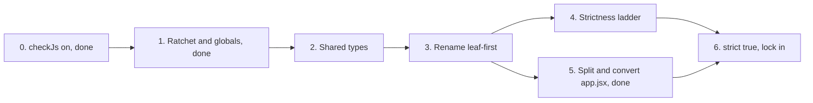

# TypeScript migration

> Archived 2026-10-25: shipped (all source and tests are `.ts`, `strict: true`, ratchet retired); folded into AGENTS.md/CLAUDE.md "TypeScript Support".

**TL;DR:** Move ProfitPath from JavaScript to TypeScript in small, always-green steps. Phases 0-5 and Phase 4 steps 1-2 are done: `noImplicitAny` and `strictNullChecks` are on, `assets/app.jsx` is split and renamed to `app.ts` (300 lines of boot wiring), and the CI ratchet is 0 errors. Remaining: the other strict flags (Phase 4 steps 3+) and Phase 6. Vite and Vitest already handle `.ts`, so there is no build change.

**Status:** Done (Phases 0-3b done 2026-10-15; Phase 4 steps 1-2 done 2026-10-16; Phase 5 done 2026-10-25)
**Fold into:** [AGENTS.md](../../../AGENTS.md) "TypeScript Support" section (done).

## Why

- 31 source files and 40 unit-test files hold the profitability math. Type errors there are silent wrong numbers.
- A compiler check on AI-written code is a cheap second reviewer.
- `tsconfig.json` and `typescript` were already installed but pointed at nothing. Now they do something.

## Baseline (measured 2026-10-14)

| Setting | Errors |
|---|---|
| `checkJs`, `strict: false` (current) | 301 |
| `checkJs`, `strict: true` (target) | 1,235 |

- **Non-strict hot spots:** `assets/app.jsx` 139 (since split), `assets/services/miscService.js` 27, `src/analytics/analytics-ui.js` 18, `assets/services/scenarioService.js` 16.
- **Non-strict causes:** mostly TS2339 (property does not exist, 241), usually untyped globals (`state`, `$`, `$$`, `XLSX`, `html2canvas`) and DOM elements typed as plain `Element`.
- **Strict adds:** about 450 implicit-any parameters (TS7006) and about 460 property errors. This is where real typing work lives.
- **Unaffected:** `vite build` passes unchanged; `tsc` is check-only (`noEmit`).

## Phases

### Phase 0: checkJs on (done)

- `tsconfig.json`: `allowJs`, `checkJs`, `noEmit`, `strict: false`; includes `src/`; test files excluded for now.
- `npm run typecheck` and `just typecheck` added.
- Interim rule in AGENTS.md: touched files become `.ts`, new code is `.ts`.

### Phase 1: ratchet and globals (done 2026-10-15)

- Result: 301 to 164 errors. `scripts/typecheck-ratchet.mjs` compares against `.typecheck-baseline`; `typecheck` runs in the unit job of `test.yml`. Globals live in `src/globals.d.ts` as `any`; Phase 2 replaces them with real types. The remaining errors are mostly DOM `Element` narrowing (TS2339).

_Original scope:_

- Add a baseline check (stored error count, CI fails if `typecheck` reports more) so the 301 can only fall.
- Declare the globals once in `src/globals.d.ts` (`state`, `$`, `$$`, `XLSX`, `html2canvas`, `window.__PP_PLATFORM__`). Expect a large drop in TS2339 and TS2304.
- Add `typecheck` to CI beside lint. Confirm CI minutes impact is negligible (about 10 s).

### Phase 2: shared types (done)

- Done 2026-10-15: `src/types.ts` has the calculation shapes (`CalcState`, `CalcResult`, `Offering`, ...) and `src/calculations/index.js` uses them via JSDoc; `state` in `assets/app.jsx` is typed `CalcState`. Baseline 164 to 162. Typing it caught a dead `.profit` read (per-offering Annual Profit always showed $0) and an early-return result missing the tax fields.
- Done 2026-10-15: `Settings`, `Scenario` and `SanitizedScenarioState` types (JSDoc on `src/settings`, the scenario helpers in `miscService`); `state`, `calc`, `lastMetrics`, `defaultOfferings` and the scenario functions in `src/globals.d.ts` are typed. Count unchanged at 162, error set identical. `calc()`'s argument is optional because it falls back to the global state.
- Left as `any` on purpose: UI/DOM helpers, CDN libraries and analytics globals. Type them as their files convert in Phase 3, not before. Export payloads are built inline as HTML/CSV strings, so there is no payload shape to type.

- Define the core shapes first in `src/types.ts`: scenario, inputs, calculation results, settings, export payloads.
- Start with `src/calculations/`, since everything else depends on its inputs and outputs. These types are what catch real bugs.
- Use them via JSDoc `@type` in files not yet renamed, so benefits arrive before the renames.

### Phase 3: rename, leaf-first

- Done 2026-10-15: `typescript-eslint` + `**/*.ts` ESLint block; Vite `esbuild` override replaced by `oxc.jsx` (the old `include` blocked `.ts` transforms); `src/calculations/index.ts` renamed with JSDoc converted to annotations (error set unchanged at 162). Its tests moved to `.test.ts` later in Phase 3.

- Order: `src/calculations`, `localization`, `settings`, `insights`, then `assets/utils`, `services`, `hooks`, `components`.
- Per file: `git mv x.js x.ts` as its own commit (keeps history), then fix types, then move its `.test.js` to `.test.ts`.
- Each step must leave `just test`, `just lint`, and the typecheck ratchet green.
- ESLint currently only matches `**/*.js` and `**/*.jsx`. Add `typescript-eslint` and a `**/*.ts` block before the first rename.
- E2E specs: `tests/e2e/app.spec.ts` is already TS; convert the rest last (Playwright runs `.ts` natively).
- Done 2026-10-15: `localization`, `settings`, `insights`, `assets/utils`, `useTableFocus` (commit 974389e), then `assets/components/{Modal,UIHelpers}`, all 7 `assets/services/*` and all 42 unit tests (`.test.ts`, excluded from `tsc` via `**/*.test.ts`). Ratchet 162 to 144, build, 431 unit tests and lint green. `app.jsx` got `miscAny`/`businessLogicAny` aliases for its `(...args)` forwarding wrappers (Phase 5 removes them).
- Real bug found: `miscService.loadIndustryTemplate` called the stateManager `persistState()` with no args, so it wrote a `"undefined"` localStorage key and never saved state. Fixed, covered by `src/test/template-persist.test.ts`.
- Kept as `.js` on purpose: `src/test/setup.js` and `test-utils.js` (Vitest `setupFiles` points at `setup.js`; converting gains nothing).
- **Phase 3 complete.** Gotchas for later renames: in `.ts` a `{}` literal is closed and missing call args error (JS treated params as optional), classes need field declarations, and JSDoc types are ignored.

### Phase 3b: analytics and accessibility

- Done 2026-10-15: all 7 `src/analytics/*` files and `assets/accessibility` renamed to `.ts` (importers and `index.html` script paths updated). Ratchet 144 to 142, build, 431 unit tests, lint and 133 e2e green. Removed a dead duplicate `trackFeedback` in `analytics.ts` (the later definition always won). Globals and DOM helpers stay `any` per the rule above.

### Phase 4: strictness ladder

Turn flags on one at a time, fixing each before the next, in this order:

1. `noImplicitAny` (the roughly 450 TS7006 errors). Done 2026-10-15: codemods added explicit `any` to about 330 params in `.ts` files (lint warnings 113 to 517) and fixed the TS7034/7019/7018/7053 sites; flag on in `tsconfig.json`. Ratchet reset 142 to 287. The extra 145 are about 208 `assets/app.jsx` errors (a `.jsx` file cannot take `: any`) that burn down in Phase 5; no TS7xxx errors remain in `.ts` files. Lint, 431 unit tests, build and 133 e2e green. Follow-up: tighten the explicit `any`s file by file.
2. `strictNullChecks` (TS18047 and TS2322 families). Done 2026-10-16: `src/types.ts` distinguishes the fully populated live app shape (`AppState`) from the legacy-compatible `CalcState`; legacy employee aliases remain optional on app state. Fixed strict-null and DOM narrowing errors across all checked files outside `assets/app.jsx`, including event targets, missing DOM elements, chart canvases, and cache lookups. The default error count fell from 287 to 208; strict-null baseline is 235, all remaining errors in `assets/app.jsx` (deferred to Phase 5).
3. `strictFunctionTypes`, `strictBindCallApply`, the rest
4. `"strict": true` and delete the individual flags

### Phase 5: `assets/app.jsx` (done 2026-10-25)

- `app.jsx` (4,362 lines) is now `assets/app.ts` (about 300 lines: boot order, `window.*` globals, URL/localStorage load, `wire()`). The ratchet went 217 to 0.
- **Modules:** `assets/state/{appState,hooks}.ts` (state, persistence, undo/redo; render callbacks for handlers) and `assets/components/{Onboarding,DebugPanel,ScenarioComparison,SensitivityPanel,AnalysisPanels,OfferingsTable,ExpensesPanel,ResourcesPanel,RangesMarketPanel,SettingsPanel,AppMenus,AppRender}.ts`, plus `assets/utils/{format,dom}.ts`.
- **Pattern:** panels export `initX({ getState, ... })` or `bindX()`, called from `app.ts` where the old block ran. Handlers import `state`, `persistState`, `pushHistoryOnce` from `appState` and call `render` through `hooks.ts`, which avoids a cycle with `AppRender.ts`.
- The custom `h` JSX pragma override is gone from `vite.config.js`; `index.html` and `package.json` `main` point at `app.ts`.
- Bug found and fixed on the way: `wire()` ran twice, so Ctrl+Z undid two steps (`tests/e2e/undo-redo.spec.ts`).

### Phase 6: lock in

- `strict: true`, ratchet baseline at 0, ratchet check replaced by a plain `tsc` gate.
- Remove JS-only config (ESLint `.js` blocks, `allowJs`, `checkJs`).
- Fold the result into AGENTS.md and delete this plan.

## Risks

| Risk | Mitigation |
|---|---|
| Behavior change from renames | Rename-only commits; tests and e2e green each step; one module per change |
| Global mutable `state` fights typing | Type it once in `globals.d.ts`; revisit after `app.jsx` is split |
| `any` creep to make errors vanish | Ratchet counts it; `no-explicit-any` as a lint warning in Phase 3 |
| Capacitor/APK build breaks | Bundling stays in Vite; run the APK build once after Phase 3 and Phase 5 |
| Long-running migration stalls | Touched-files rule makes progress on its own; revisit order if a phase sits for 2 months |

## Done when

- No `.js` or `.jsx` under `assets/`, `src/`, or `tests/` (config files excepted).
- `tsc` passes with `strict: true` and zero baseline.
- `just test` and `just lint` pass, and the APK build still succeeds.
- AGENTS.md describes the final state and this plan is deleted.
