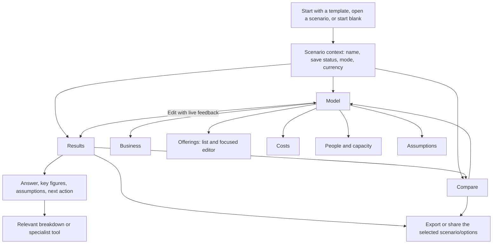

# ProfitPath product-flow redesign

**TL;DR:** Replace the long Inputs/Outputs page with Model, Results, and Compare workspaces inside one scenario context. Keep live feedback while editing, make each offering manageable on its own, and reveal specialist tools when they help answer a question.

**Status:** Draft — workspace direction accepted by Tim on 2026-10-28; detailed design and implementation gates remain open.

**Last updated:** 2026-10-28

**Scope:** [ROADMAP recommended priority #1 / item 25](../../ROADMAP.md): navigation, onboarding, model editing, results hierarchy, contextual disclosure, accessibility, and mobile flow.

**Fold into:** [FEATURES.md](../../FEATURES.md), [experience-levels.md](../experience-levels.md), and architecture notes in [AGENTS.md](../../AGENTS.md).

**Related:** [Previous containment pass](archive/ui-ux-pass.md), [heuristic audit](../usability-audit-heuristics-profitpath.md), [historical live evidence](../ledger/UI_UX_PHASE0_LIVE_EVIDENCE.md), [decision workbench](decision-workbench.md).

## Contents

- [Overview](#overview)
- [Evidence and limits](#evidence-and-limits)
- [Recommended information architecture](#recommended-information-architecture)
- [Screen and interaction design](#screen-and-interaction-design)
- [Disclosure and language](#disclosure-and-language)
- [Journeys and acceptance criteria](#journeys-and-acceptance-criteria)
- [Implementation approach](#implementation-approach)
- [Delivery phases](#delivery-phases)
- [Risks and rollback](#risks-and-rollback)
- [Alternatives considered](#alternatives-considered)
- [Decisions and open items](#decisions-and-open-items)

## Overview

- **Accepted direction:** Model / Results / Compare, with optional first-time guidance. This is a change in workflow, not another layer of accordions.
- Model answers “What does my business look like?” Results answers “Does it work?” Compare answers “Which change should I make?”
- Retain a compact live result summary while editing. Separating workspaces must not turn every price change into a navigation chore.
- Keep every existing capability reachable. Reduce simultaneous decisions, duplicate totals, and irrelevant fields rather than removing useful information.
- Preserve the calculation engine, scenario formats, imports, exports, and client-side privacy model. A framework migration or backend is unnecessary.
- Item 25 owns the workspace and navigation. Item 38 owns the richer comparison math and verdict; item 39 owns membership-derived warnings. Neither blocks the basic redesign.

## Evidence and limits

### What the previous audits establish

The 2026-10-27 heuristic audit reported 7/10 usability and emphasized long Setup/Outputs flows, inconsistent disclosure, and hidden value in advanced tools. The separate live record reported mobile overflow, a welcome interruption, 19 exposed advanced controls, and difficulty navigating 12 offerings.

These records are not a reliable current baseline: the heuristic report explicitly says browser work was deferred, while the live record says it occurred. The heuristic report also contains later “Fixed” edits. Preserve them as historical evidence; do not infer current defects, measured user success, or a comparable score from them.

The shipped pass added useful containment: persisted Setup groups, sticky totals, and Analyze/Customers tabs. It did not separate building the model from interpreting it. The reopened roadmap and Tim's request establish that this broader problem remains.

### Fresh production walkthrough — 2026-10-28

Inspected [the deployed app](https://profitpath.tsyche.workers.dev/) using Chrome DevTools in a new isolated browser context, separate from existing scenarios. Actions: open the fresh app, choose Fitness & Wellness through onboarding, dismiss the follow-up tour invitation, inspect desktop, emulate mobile, dismiss welcome again, and open Settings.

| Observation | Evidence | Design consequence |
|---|---|---|
| Desktop still presents two large Inputs/Outputs streams | At 1440×900, staffing and fee inputs compete with numerous equally weighted result cards; revenue, income, and utilization recur in multiple summaries | One active task area, one compact editing summary, a clear result hierarchy |
| Model concepts remain scattered | Business basics contains overhead and payment fees; a separate Costs section contains expense rows | Put business-wide cost controls together |
| Three offerings already create a long mobile editor | At verified `innerWidth=375`, Service Offerings heading was about 1,828 CSS px down and Outputs about 5,736 px down, with default groups open | A short offering list plus focused editor; direct Results navigation |
| First-run guidance still competes with use | Industry selection loaded the template, then offered another tour; welcome appeared again after mobile emulation | Optional inline guidance; test reload and device-mode transitions explicitly |
| Settings language contradicts documented capabilities | Beginner summary said “Full export suite” was locked; current experience-level documentation says exports are always available | Replace capability-lock language with accurate detail preferences |

At 375px, the sampled document width was 375px: the historical overflow was **not reproduced in that state**. This does not establish that every panel, dialog, theme, or keyboard state fits.

**Limits:** This was a focused planning walkthrough, not a completed usability audit. No timed participant study, 12-offering rerun, stable Advanced-state verification, screen-reader test, full keyboard journey, or export round trip was completed. Mobile emulation is not a physical-device test. The deployed version shown in Settings was `0.8.58-beta`; record the tested build again at Phase 0.

Phase 0 must capture screenshots, interaction steps, fixtures, and measurements together in the existing [live-evidence record](../ledger/UI_UX_PHASE0_LIVE_EVIDENCE.md), as a dated addition. This supersedes the contradictory baseline for implementation without rewriting history.

## Recommended information architecture

**Global context:** scenario switcher, name, explicit saved/modified state, Save, undo/redo, and Share/export. Templates belong under New scenario. Settings/help sit in a secondary menu. Scenario management is context, not a fourth full-time workspace.

**Primary navigation:** Model, Results, Compare. Use a compact desktop navigation rail or bar and three labeled mobile bottom destinations. Keep the same names and order across devices. Do not bury the main destinations behind the hamburger.

**Model navigation:** Business, Offerings, Costs, People & capacity, Assumptions. Desktop shows a local section list; mobile shows the current section and an accessible section picker. These are freely navigable sections, not mandatory sequential steps.

**New users:** start in Model with a short checklist. **Returning users:** resume the current draft and workspace. **Imported/shared scenarios:** show their context and Results after existing validation/import handling. Never silently replace a local draft on opening a link.

## Screen and interaction design

### 1. Entry and scenario context

- Replace the timed welcome overlay with an inline choice: “Use an example,” “Start blank,” or “Open a saved scenario.” Shared links bypass generic onboarding.
- Preview a template's business model and sample assumptions before use. Clearly mark example data until the user customizes it; do not imply it represents their business.
- Guide the user through business mode, offerings, people/capacity, and costs with a resumable checklist. Optional assumptions stay optional. Results remain available throughout, with incomplete-input notices.
- Explain modes by the question: “What can my capacity support? (Forecast)” and “How does my current customer base perform? (Current).” Forecast is capacity-derived, not a demand forecast or sales promise.
- Distinguish the automatically retained working draft from an explicitly saved scenario. “Draft saved on this device” must not imply a named scenario was updated.
- Duplicate before exploring an alternative through “Try a change.” Preview the duplicate and let the user name it; preserve the baseline.

### 2. Model and focused offering editor

The default offering list shows name, type, price with its actual unit, mode-specific demand/mix, and one useful outcome. It supports search by name and a type filter so a 12-offering business remains navigable.

Selecting an offering opens an editor beside the list on wide screens and as a full-width subview on mobile. Back returns to the same list position and selected row. Keep the price and type at the top; show relevant fields only:

| Field group | Contents and behavior |
|---|---|
| Core service | Name, type, price unit, frequency, duration, and current clients or forecast mix |
| Delivery and costs | Per-session variable cost, contractor labor, resource assignment; group seats, fill, and run cost only when relevant |
| Pricing assumptions | Discounts and sales loss; show a “Try a price change” action linking price and sales-loss assumptions |
| Uncertainty and context | Confidence, note, low/high bounds, market information; summarized before expansion |

Use existing per-session and one-time price conversion helpers. Never store an extra competing price. Switching type must preserve existing data according to the established conversion rules.

Keep optional desktop table editing for people entering many prices. Reuse the same validation and mutation handlers for both views; do not build two business-logic implementations. Begin with existing table capabilities rather than adding bulk editing.

**Editing contract:** valid edits update the working model and live summary; undo works across workspace changes. Temporarily invalid or partial input remains visible with an inline error rather than silently becoming zero. Show “Results use the last valid value” when relevant. Confirm how this fits existing handlers before implementation; never export unseen invalid input.

**Costs:** bring overhead, processing fees, expense rows, purchases, and loans into one destination. Explain the difference between profit and cash flow beside purchases/loans. Payroll is entered under People & capacity; Costs links to it and includes its total without a second editable copy.

**Assumptions:** provide a compact review list of estimates and warnings with “Edit source” links. Offering-specific inputs stay in the offering editor; this page must not become a second editable copy of every field.

### 3. Results

Lead with a short, deterministic statement of the modeled outcome, its period, and active case. Example structure: “This model produces [net income] per year before estimated tax, at [utilization] of productive capacity.” Use actual calculator values and explicit limitations, not an invented health score.

The first screen contains:

1. Scenario, mode, currency, and Base/Conservative/Optimistic context.
2. Three primary figures: net income before tax, revenue, and capacity utilization.
3. A break-even summary and the most material warning or assumption.
4. One clear next action: edit the model, try a change, or compare saved options.

Below that, show question-led entry points: “Where does the money go?”, “Which services contribute most?”, “What limits growth?”, and “What would reach my income target?” Each opens its relevant breakdown or existing tool.

Retain take-home estimates and Year 1 cash flow as clearly labeled secondary results; neither is interchangeable with net income. Do not change default reporting periods during this redesign. Any future monthly equivalent must be labeled as an annual average, not actual seasonal cash flow.

Show charts when they explain a question. Avoid several gauges and cards repeating utilization on the same screen. Chart details have equivalent text/table access. Keep confidence labels visible without implying statistical certainty.

### 4. Compare and share

- Provide baseline and alternative selection, with a useful empty state: “Save an option to compare with this scenario.”
- Initially relocate the existing two-scenario comparison. Offer “Edit this option” with an obvious return to comparison.
- Add 2–4 options, offering deltas, goal line, break-even sales loss, and verdict only through [decision workbench Phase 3](decision-workbench.md). Do not duplicate that scope here.
- On mobile, select a baseline and one alternative at a time; retain access to every option and detail without compressing four columns into a phone.
- Place Share/export beside the conclusion. Preview the included scenario(s), active case, and notes; explain that links are snapshots.
- Preserve all export formats and current sanitizers. Show progress and recoverable errors. A selected case must not be silently lost in a share/export; verify existing format behavior before promising parity.
- Existing notes serve as the conclusion initially. Avoid a new decision-record schema until a demonstrated need justifies it.

### 5. Visual direction and responsive behavior

Keep the ProfitPath identity and light/dark themes. Use neutral surfaces, fewer nested cards, sentence-case labels, stronger type hierarchy, and one accent for the primary action. Reserve warning colors for explained conditions, not decorative emphasis.

On Model, keep one compact result summary with a direct Results link. Mobile uses a small summary above the bottom navigation; opening the software keyboard must not obscure the field, error, or save/back action. Avoid simultaneous sticky header, large summary, and footer stacks.

Use a 44px minimum target for primary touch controls. At 375px, neither the page nor the focused editor should require horizontal scrolling. Any optional dense table needs a labeled local scrolling region and an accessible list alternative.

## Disclosure and language

**Proposed policy:** experience levels choose initial detail, not whether the user can model their actual business.

- Basic inputs affecting revenue, cost, or capacity remain discoverable at every level. A resource-dependent service or group run must not hide essential cost/capacity inputs behind Advanced.
- Existing scenarios with specialist values display an “In use” summary and direct editing route at every level. Changing level never clears or silently disables modeled values.
- Ranges, market comparisons, optimizers, and specialist charts begin collapsed or appear through relevant questions. Advanced enables denser editing and more detail; it does not expand every panel.
- Make Compare discoverable at every level if this policy is approved. Treat this as an explicit change to current feature gates, not a navigation-only refactor.
- Keep diagnostics in Settings. Keep exports available to everyone. Offer help consistently rather than removing explanations solely because Advanced is selected.
- Prefer “Time available for client work” with the technical term “productive utilization” in help; retain precise units and distinguish customers, visits, classes, seats, and sales.

This policy changes the earlier rule that hid Resources and Group runs from Beginner. The reason is concrete: these values can change the core answer. Confirm the revised feature matrix in Phase 1 and update `docs/experience-levels.md` when it ships.

## Journeys and acceptance criteria

Targets below are proposed release gates, not measured outcomes. Phase 0 records the old flow; Phase 1 validates targets with the prototype.

| Journey | Required outcome | Proof |
|---|---|---|
| First model from Fitness template | Identify example data, edit a price, find annual income and its assumptions without a mandatory tour | Beginner participant task; target ≤5 minutes without coaching; Playwright follows the same path |
| 12-offering hybrid business | Find and edit a named offering, its resource/run cost, and a business expense without traversing unrelated editors | Search/list/editor integration plus desktop and 375px E2E; no value loss across sections |
| Price change with sales loss | Preserve baseline, change price and loss, inspect both effects, undo, and save an alternative | Real state + calculator integration in Forecast and Current; E2E round trip |
| Compare options | Select baseline, understand deltas, return to an option, and recover comparison context | Existing two-option comparison for item 25; three-option bundle gate for item 38 |
| Export/share the conclusion | Identify included scenario, case, units, notes, and snapshot behavior; recipient sees matching supported values | Export/share round trip; no silent active-case reset |
| Keyboard and screen reader | Navigate sections, edit, recover from invalid input, and return focus to the initiating control | Keyboard E2E, axe, and human screen-reader walkthrough |
| Mobile and returning use | Reach Results in one primary-navigation action; resume without onboarding interruption or state loss | 375×812, software-keyboard/manual-device check, reload/back tests |

Cross-cutting gates:

- No calculation changes for unchanged inputs: compare golden scenario results before/after, including group, one-time, staff-free resources, loans, and active range cases.
- No data loss when switching workspace, section, experience level, scenario, or browser history.
- Every tool has one documented home and a context link; no blank destination caused by feature gating.
- Light/dark contrast, focus visibility, 200% zoom/reflow, reduced motion, and readable chart alternatives pass review.
- A field correction automatically reveals and focuses its source. Updates announce a concise status rather than reading every changing KPI.
- New users can explain what to do next and distinguish net income, take-home, and cash flow. Automated tests alone cannot prove this.
- Target a small formative walkthrough with 3–5 service-business users, including a newcomer and a dense-model user. Record failures and task times; do not treat this sample as statistical validation.

## Implementation approach

Reuse the existing TypeScript/Vite app and global state. Introduce a small workspace-navigation controller and scoped view composition; no framework, state-store, or database migration.

| Existing surface | Planned responsibility |
|---|---|
| `assets/app.ts`, `index.html` | Boot order, scenario import precedence, workspace landmarks and navigation |
| `assets/components/AppRender.ts`, state hooks | One calculation/update path; compact summary and Results consume the same result |
| `OfferingsTable.ts` | Shared field mutations for list/detail and retained table view |
| Expenses, Resources, RangesMarket, GroupRuns panels | Rehome controls while preserving domain logic; link to canonical editors |
| `AnalysisTabs.ts`, `SetupGroups.ts` | Reuse useful behavior; retire obsolete containment once new navigation is proven |
| `ScenarioComparison.ts`, scenario service, AppMenus | Existing compare/save/duplicate/share flows within the scenario context |
| `Onboarding.ts`, SettingsPanel, settings gates | Inline optional guidance and the approved detail matrix |
| `assets/styles.css` | Shared spacing, type, surface, focus, and mobile rules |

Keep navigation preferences separate from financial state and undo history. Browser Back should navigate views; Undo should undo model edits. Use a small allowlisted URL/view representation that preserves existing share/import parameters and falls back safely for invalid destinations. Inspect current URL cleanup and startup order before choosing its exact encoding.

Avoid duplicate DOM IDs and bindings when moving panels. Hidden views must not remain keyboard-focusable. Charts must resize after becoming visible, and lazy loading must remain lazy. Preserve working-draft persistence failures as visible, recoverable states.

The focused editor may keep transient invalid text locally, but must not fork the persisted business model. Reuse the existing sanitizers and history grouping. All calculation semantics remain owned by `src/calculations/`.

## Delivery phases

Effort ranges are rough engineering estimates, not delivery commitments; they exclude participant scheduling and assume existing component reuse.

| Phase | Deliverable | Verification gate | Estimate |
|---|---|---|---|
| 0. Establish baseline | Reproducible desktop/mobile evidence, beginner/advanced fixtures, 12-offering model, task inventory and feature-to-destination map | Reconcile historical findings; record current failures, build, screenshots, and task paths | 0.5–1 day |
| 1. Validate design | Clickable desktop/mobile prototype of entry, offering editor, Results, and Compare; revised feature matrix | Tim reviews concrete screens; walkthrough proves the edit-and-see loop and identifies terminology problems | 1–2 days |
| 2. Establish workspace shell | Scenario context, Model/Results/Compare navigation, view persistence, back/focus behavior | Existing saved/share scenarios load unchanged; baseline calculations match; keyboard/mobile shell passes | 1–2 days |
| 3. Rebuild model flow | Offering list/detail, consolidated costs, capacity context, optional onboarding | Template and 12-offering journeys pass in both modes, including invalid input and undo | 2–4 days |
| 4. Rebuild result flow | Outcome hierarchy, contextual tools, existing comparison, share/export entry | Result-to-edit return loop, export/share parity, and approved gating matrix pass | 1.5–3 days |
| 5. Validate and finalize | Human walkthrough, accessibility/mobile review, regression fixes, official docs | All acceptance gates pass; re-score against the recorded baseline; no critical journey blocked | 1–2 days |

**Ballpark:** 7–14 engineering days for the complete redesign, refined after Phase 1. The cheaper coherent release keeps the existing two-option comparison and existing table as the dense editing option; it still delivers Model/Results separation and a focused mobile editor. Item 38/39 enhancements remain separately estimated.

For code phases run `just lint`, `just typecheck`, `just test-unit`, and `just build`, plus relevant Chromium/Firefox journey and axe tests. Run the full E2E suite before final cutover. For every confirmed bug fixed, add the smallest real regression test and demonstrate failure before the fix and success after it.

`ROADMAP.md` remains the authority for unfinished work. Update item 25 as phases ship; preserve deferred acceptance gaps there. At completion, fold durable behavior into official docs, add the shipped ledger entry, and archive this plan with a dated stamp.

## Risks and rollback

| Risk | Mitigation |
|---|---|
| Workspaces slow down quick experimentation | Keep compact live results in Model and direct return-to-field links; measure price-edit journey before committing the design |
| Focused editor becomes another giant form | Type-specific fields, short groups, and context links; prototype the 12-offering case first |
| Simplification hides material inputs | “In use” summaries and access to canonical editors at every level; scenario round-trip tests |
| Confusing auto-save and named saves | Separate working-draft and saved-scenario status; test reload and switching explicitly |
| Attractive results imply certainty | Persistent mode/case/units and assumption notices; precise distinction between profit and cash flow |
| Existing DOM-centric code breaks when moved | Stable IDs where practical, one binding per control, real-component integration and browser tests |
| Redesign expands into comparison or modeling work | Keep items 38/39 separately owned; schema/math changes require a demonstrated requirement |

Roll out cohesive slices locally behind a temporary layout switch sharing the same state and calculations. Keep the current layout available through acceptance testing, then remove the switch and obsolete markup once the new flow is proven. Do not maintain two permanent products.

Rollback restores the previous shell/assets without transforming scenario data. New navigation preferences can be ignored by the old UI. Verify the rollback with saved drafts and share links, and include the service worker/offline asset cache in release checks. Do not reset user storage to resolve a UI migration issue.

## Alternatives considered

| Approach | Strength | Tradeoff / when it wins |
|---|---|---|
| **Model / Results / Compare with optional guidance — accepted direction** | Separates tasks while preserving iteration and specialist depth | Requires deliberate context and return paths |
| Mandatory step-by-step wizard | Clear first-run sequence | Poor fit for recurring edits and hybrid businesses; use only as optional guidance |
| More accordions/tabs in the existing page | Lowest implementation cost | Repeats the shipped containment pass; useful within a workspace, insufficient as the overall solution |
| Dashboard-first with every tool in a sidebar | Fast for experienced users with complete data | Weak first-model path and risks creating another wall of metrics |
| Scenario library as a mandatory home screen | Useful for users managing many saved options | Adds friction for a single working model; use a switcher with optional library view |
| Full framework/design-system rewrite | Can simplify a future larger product | Adds migration risk without resolving the information architecture; reconsider only with independent technical evidence |

## Decisions and open items

| State | Decision |
|---|---|
| Confirmed by Tim, 2026-10-28 | Favor Model / Results / Compare with optional first-time guidance |
| Planning constraint | Preserve current calculations, client-side storage, saved scenarios, and share/import compatibility |
| Proposed for prototype | Focused offering editor, compact live summary, three primary Results figures |
| Proposed for Phase 1 approval | Experience levels become detail preferences; core modeled inputs and Compare remain discoverable at every level |
| Pending prototype review | Exact navigation placement, result wording, and offering-editor grouping on desktop/mobile |
| Pending validation | Full current baseline, participant availability, task targets, and active-case export/share behavior |

Next step: complete Phase 0 and produce the Phase 1 clickable prototype for review. This document authorizes no application implementation by itself; the current request is the redesign plan.
