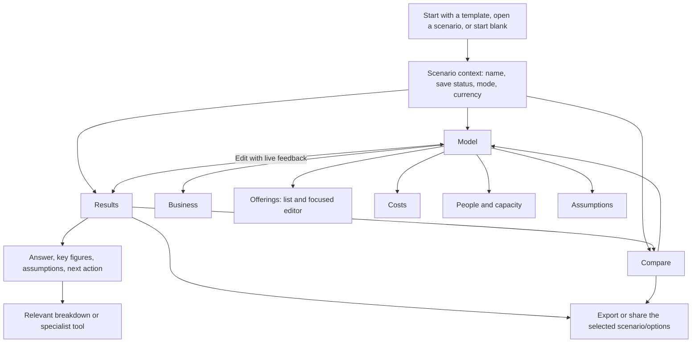

# ProfitPath product-flow redesign

**TL;DR:** Introduce Model, Results, and Compare workspaces inside one scenario context, with a remembered Settings choice between the original Classic layout and Workspaces during the transition. Keep live feedback while editing, make each offering manageable on its own, and reveal specialist tools when they help answer a question.

**Status:** Building — Tim approved continuation with feature parity on 2026-10-28 and requested a user-visible layout choice on 2026-10-29. The Phase 2 shell and substantial Phase 3–4 implementation are available through Settings → Layout or `?layout=workspaces`; remaining validation and cutover gates are open.

**Last updated:** 2026-10-29

**Scope:** [ROADMAP recommended priority #1 / item 25](../../ROADMAP.md): navigation, onboarding, model editing, results hierarchy, contextual disclosure, accessibility, and mobile flow.

**Fold into:** [FEATURES.md](../../FEATURES.md), [experience-levels.md](../experience-levels.md), and architecture notes in [AGENTS.md](../../AGENTS.md).

**Related:** [Previous containment pass](archive/ui-ux-pass.md), [heuristic audit](../usability-audit-heuristics-profitpath.md), [historical live evidence](../ledger/UI_UX_PHASE0_LIVE_EVIDENCE.md), [decision workbench](decision-workbench.md).

## Contents

- [Overview](#overview)
- [Evidence and limits](#evidence-and-limits)
- [Recommended information architecture](#recommended-information-architecture)
- [Screen and interaction design](#screen-and-interaction-design)
- [Disclosure and language](#disclosure-and-language)
- [Journeys and acceptance criteria](#journeys-and-acceptance-criteria)
- [Implementation approach](#implementation-approach)
- [Delivery phases](#delivery-phases)
- [Risks and rollback](#risks-and-rollback)
- [Alternatives considered](#alternatives-considered)
- [Decisions and open items](#decisions-and-open-items)

## Overview

- **Accepted direction:** Model / Results / Compare, with optional first-time guidance. This is a change in workflow, not another layer of accordions.
- Model answers “What does my business look like?” Results answers “Does it work?” Compare answers “Which change should I make?”
- Retain a compact live result summary while editing. Separating workspaces must not turn every price change into a navigation chore.
- Keep every existing capability reachable. Reduce simultaneous decisions, duplicate totals, and irrelevant fields rather than removing useful information.
- Preserve the calculation engine, scenario formats, imports, exports, and client-side privacy model. A framework migration or backend is unnecessary.
- Item 25 owns the workspace and navigation. Item 38 owns the richer comparison math and verdict; item 39 owns membership-derived warnings. Neither blocks the basic redesign.

## Evidence and limits

### What the previous audits establish

The 2026-10-27 heuristic audit reported 7/10 usability and emphasized long Setup/Outputs flows, inconsistent disclosure, and hidden value in advanced tools. The separate live record reported mobile overflow, a welcome interruption, 19 exposed advanced controls, and difficulty navigating 12 offerings.

These records are not a reliable current baseline: the heuristic report explicitly says browser work was deferred, while the live record says it occurred. The heuristic report also contains later “Fixed” edits. Preserve them as historical evidence; do not infer current defects, measured user success, or a comparable score from them.

The shipped pass added useful containment: persisted Setup groups, sticky totals, and Analyze/Customers tabs. It did not separate building the model from interpreting it. The reopened roadmap and Tim's request establish that this broader problem remains.

### Fresh production walkthrough — 2026-10-28

Inspected [the deployed app](https://profitpath.tsyche.workers.dev/) using Chrome DevTools in a new isolated browser context, separate from existing scenarios. Actions: open the fresh app, choose Fitness & Wellness through onboarding, dismiss the follow-up tour invitation, inspect desktop, emulate mobile, dismiss welcome again, and open Settings.

| Observation | Evidence | Design consequence |
|---|---|---|
| Desktop still presents two large Inputs/Outputs streams | At 1440×900, staffing and fee inputs compete with numerous equally weighted result cards; revenue, income, and utilization recur in multiple summaries | One active task area, one compact editing summary, a clear result hierarchy |
| Model concepts remain scattered | Business basics contains overhead and payment fees; a separate Costs section contains expense rows | Put business-wide cost controls together |
| Three offerings already create a long mobile editor | At verified `innerWidth=375`, Service Offerings heading was about 1,828 CSS px down and Outputs about 5,736 px down, with default groups open | A short offering list plus focused editor; direct Results navigation |
| First-run guidance still competes with use | Industry selection loaded the template, then offered another tour; welcome appeared again after mobile emulation | Optional inline guidance; test reload and device-mode transitions explicitly |
| Settings language contradicts documented capabilities | Beginner summary said “Full export suite” was locked; current experience-level documentation says exports are always available | Replace capability-lock language with accurate detail preferences |

At 375px, the sampled document width was 375px: the historical overflow was **not reproduced in that state**. This does not establish that every panel, dialog, theme, or keyboard state fits.

**Limits:** This was a focused planning walkthrough, not a completed usability audit. No timed participant study, 12-offering rerun, stable Advanced-state verification, screen-reader test, full keyboard journey, or export round trip was completed. Mobile emulation is not a physical-device test. The deployed version shown in Settings was `0.8.58-beta`; record the tested build again at Phase 0.

Phase 0 must capture screenshots, interaction steps, fixtures, and measurements together in the existing [live-evidence record](../ledger/UI_UX_PHASE0_LIVE_EVIDENCE.md), as a dated addition. This supersedes the contradictory baseline for implementation without rewriting history.

**Phase 0 completed, 2026-10-28:** the [reproducible baseline](../ledger/UI_UX_PHASE0_LIVE_EVIDENCE.md#product-flow-baseline--2026-10-28) now records both browsers, desktop/mobile, Beginner/Fitness and Advanced/12-offering fixtures, screenshots, six calculation goldens, current failures, and task paths. The dense mobile model places Costs around 15,600px and net income around 17,800px down. Sampled horizontal page overflow and the historical 19-control count were not reproduced. Partial price entry persists zero, onboarding returns after Explore/reload, and non-Base shares reopen on Base.

## Recommended information architecture

**Global context:** scenario switcher, name, explicit saved/modified state, Save, undo/redo, and Share/export. Templates belong under New scenario. Settings/help sit in a secondary menu. Scenario management is context, not a fourth full-time workspace.

**Primary navigation:** Model, Results, Compare. Use a compact desktop navigation rail or bar and three labeled mobile bottom destinations. Keep the same names and order across devices. Do not bury the main destinations behind the hamburger.

**Model navigation:** Business, Offerings, Costs, People & capacity, Assumptions. Desktop shows a local section list; mobile shows the current section and an accessible section picker. These are freely navigable sections, not mandatory sequential steps.

**New users:** start in Model with a short checklist. **Returning users:** resume the current draft and workspace. **Imported/shared scenarios:** show their context and Results after existing validation/import handling. Never silently replace a local draft on opening a link.

## Screen and interaction design

### 1. Entry and scenario context

- Replace the timed welcome overlay with an inline choice: “Use an example,” “Start blank,” or “Open a saved scenario.” Shared links bypass generic onboarding.
- Preview a template's business model and sample assumptions before use. Clearly mark example data until the user customizes it; do not imply it represents their business.
- Guide the user through business mode, offerings, people/capacity, and costs with a resumable checklist. Optional assumptions stay optional. Results remain available throughout, with incomplete-input notices.
- Explain modes by the question: “What can my capacity support? (Forecast)” and “How does my current customer base perform? (Current).” Forecast is capacity-derived, not a demand forecast or sales promise.
- Distinguish the automatically retained working draft from an explicitly saved scenario. “Draft saved on this device” must not imply a named scenario was updated.
- Duplicate before exploring through **Create alternative** (originally “Try a change”). Let the user name the alternative and preserve the saved baseline.

### 2. Model and focused offering editor

The default offering list shows name, type, price with its actual unit, mode-specific demand/mix, and one useful outcome. It supports search by name and a type filter so a 12-offering business remains navigable.

Selecting an offering opens an editor beside the list on wide screens and as a full-width subview on mobile. Back returns to the same list position and selected row. Keep the price and type at the top; show relevant fields only:

| Field group | Contents and behavior |
|---|---|
| Core service | Name, type, price unit, frequency, duration, and current clients or forecast mix |
| Delivery and costs | Per-session variable cost, contractor labor, resource assignment; group seats, fill, and run cost only when relevant |
| Pricing assumptions | Discounts and sales loss; show a “Try a price change” action linking price and sales-loss assumptions |
| Uncertainty and context | Confidence, note, low/high bounds, market information; summarized before expansion |

Use existing per-session and one-time price conversion helpers. Never store an extra competing price. Switching type must preserve existing data according to the established conversion rules.

Keep optional desktop table editing for people entering many prices. Reuse the same validation and mutation handlers for both views; do not build two business-logic implementations. Begin with existing table capabilities rather than adding bulk editing.

**Editing contract:** valid edits update the working model and live summary; undo works across workspace changes. Temporarily invalid or partial input remains visible with an inline error rather than silently becoming zero. Show “Results use the last valid value” when relevant. Confirm how this fits existing handlers before implementation; never export unseen invalid input.

**Costs:** bring overhead, processing fees, expense rows, purchases, and loans into one destination. Explain the difference between profit and cash flow beside purchases/loans. Payroll is entered under People & capacity; Costs links to it and includes its total without a second editable copy.

**Assumptions:** provide a compact review list of estimates and warnings with “Edit source” links. Offering-specific inputs stay in the offering editor; this page must not become a second editable copy of every field.

### 3. Results

Lead with a short, deterministic statement of the modeled outcome, its period, and active case. Example structure: “This model produces [net income] per year before estimated tax, at [utilization] of productive capacity.” Use actual calculator values and explicit limitations, not an invented health score.

The first screen contains:

1. Scenario, mode, currency, and Base/Conservative/Optimistic context.
2. Three primary figures: net income before tax, revenue, and capacity utilization.
3. A break-even summary and the most material warning or assumption.
4. One clear next action: edit the model, try a change, or compare saved options.

Below that, show question-led entry points: “Where does the money go?”, “Which services contribute most?”, “What limits growth?”, and “What would reach my income target?” Each opens its relevant breakdown or existing tool.

Retain take-home estimates and Year 1 cash flow as clearly labeled secondary results; neither is interchangeable with net income. Do not change default reporting periods during this redesign. Any future monthly equivalent must be labeled as an annual average, not actual seasonal cash flow.

Show charts when they explain a question. Avoid several gauges and cards repeating utilization on the same screen. Chart details have equivalent text/table access. Keep confidence labels visible without implying statistical certainty.

### 4. Compare and share

- Provide baseline and alternative selection, with a useful empty state: “Save an option to compare with this scenario.”
- Initially relocate the existing two-scenario comparison. Offer “Edit this option” with an obvious return to comparison.
- Add 2–4 options, offering deltas, goal line, break-even sales loss, and verdict only through [decision workbench Phase 3](decision-workbench.md). Do not duplicate that scope here.
- On mobile, select a baseline and one alternative at a time; retain access to every option and detail without compressing four columns into a phone.
- Place Share/export beside the conclusion. Preview the included scenario(s), active case, and notes; explain that links are snapshots.
- Preserve all export formats and current sanitizers. Show progress and recoverable errors. A selected case must not be silently lost in a share/export; verify existing format behavior before promising parity.
- Existing notes serve as the conclusion initially. Avoid a new decision-record schema until a demonstrated need justifies it.

### 5. Visual direction and responsive behavior

Keep the ProfitPath identity and light/dark themes. Use neutral surfaces, fewer nested cards, sentence-case labels, stronger type hierarchy, and one accent for the primary action. Reserve warning colors for explained conditions, not decorative emphasis.

On Model, keep one compact result summary with a direct Results link. Mobile uses a small summary above the bottom navigation; opening the software keyboard must not obscure the field, error, or save/back action. Avoid simultaneous sticky header, large summary, and footer stacks.

Use a 44px minimum target for primary touch controls. At 375px, neither the page nor the focused editor should require horizontal scrolling. Any optional dense table needs a labeled local scrolling region and an accessible list alternative.

## Disclosure and language

**Proposed policy:** experience levels choose initial detail, not whether the user can model their actual business.

- Basic inputs affecting revenue, cost, or capacity remain discoverable at every level. A resource-dependent service or group run must not hide essential cost/capacity inputs behind Advanced.
- Existing scenarios with specialist values display an “In use” summary and direct editing route at every level. Changing level never clears or silently disables modeled values.
- Ranges, market comparisons, optimizers, and specialist charts begin collapsed or appear through relevant questions. Advanced enables denser editing and more detail; it does not expand every panel.
- Make Compare discoverable at every level if this policy is approved. Treat this as an explicit change to current feature gates, not a navigation-only refactor.
- Keep diagnostics in Settings. Keep exports available to everyone. Offer help consistently rather than removing explanations solely because Advanced is selected.
- Prefer “Time available for client work” with the technical term “productive utilization” in help; retain precise units and distinguish customers, visits, classes, seats, and sales.

This policy changes the earlier rule that hid Resources and Group runs from Beginner. The reason is concrete: these values can change the core answer. Confirm the revised feature matrix in Phase 1 and update `docs/experience-levels.md` when it ships.

## Journeys and acceptance criteria

Targets below are proposed release gates, not measured outcomes. Phase 0 records the old flow; Phase 1 validates targets with the prototype.

| Journey | Required outcome | Proof |
|---|---|---|
| First model from Fitness template | Identify example data, edit a price, find annual income and its assumptions without a mandatory tour | Beginner participant task; target ≤5 minutes without coaching; Playwright follows the same path |
| 12-offering hybrid business | Find and edit a named offering, its resource/run cost, and a business expense without traversing unrelated editors | Search/list/editor integration plus desktop and 375px E2E; no value loss across sections |
| Price change with sales loss | Preserve baseline, change price and loss, inspect both effects, undo, and save an alternative | Real state + calculator integration in Forecast and Current; E2E round trip |
| Compare options | Select baseline, understand deltas, return to an option, and recover comparison context | Existing two-option comparison for item 25; three-option bundle gate for item 38 |
| Export/share the conclusion | Identify included scenario, case, units, notes, and snapshot behavior; recipient sees matching supported values | Export/share round trip; no silent active-case reset |
| Keyboard and screen reader | Navigate sections, edit, recover from invalid input, and return focus to the initiating control | Keyboard E2E, axe, and human screen-reader walkthrough |
| Mobile and returning use | Reach Results in one primary-navigation action; resume without onboarding interruption or state loss | 375×812, software-keyboard/manual-device check, reload/back tests |

Cross-cutting gates:

- No calculation changes for unchanged inputs: compare golden scenario results before/after, including group, one-time, staff-free resources, loans, and active range cases.
- No data loss when switching workspace, section, experience level, scenario, or browser history.
- Every tool has one documented home and a context link; no blank destination caused by feature gating.
- Light/dark contrast, focus visibility, 200% zoom/reflow, reduced motion, and readable chart alternatives pass review.
- A field correction automatically reveals and focuses its source. Updates announce a concise status rather than reading every changing KPI.
- New users can explain what to do next and distinguish net income, take-home, and cash flow. Automated tests alone cannot prove this.
- Target a small formative walkthrough with 3–5 service-business users, including a newcomer and a dense-model user. Record failures and task times; do not treat this sample as statistical validation.

## Implementation approach

Reuse the existing TypeScript/Vite app and global state. Introduce a small workspace-navigation controller and scoped view composition; no framework, state-store, or database migration.

| Existing surface | Planned responsibility |
|---|---|
| `assets/app.ts`, `index.html` | Boot order, scenario import precedence, workspace landmarks and navigation |
| `assets/components/AppRender.ts`, state hooks | One calculation/update path; compact summary and Results consume the same result |
| `OfferingsTable.ts` | Shared field mutations for list/detail and retained table view |
| Expenses, Resources, RangesMarket, GroupRuns panels | Rehome controls while preserving domain logic; link to canonical editors |
| `AnalysisTabs.ts`, `SetupGroups.ts` | Reuse useful behavior; retire obsolete containment once new navigation is proven |
| `ScenarioComparison.ts`, scenario service, AppMenus | Existing compare/save/duplicate/share flows within the scenario context |
| `Onboarding.ts`, SettingsPanel, settings gates | Inline optional guidance and the approved detail matrix |
| `assets/styles.css` | Shared spacing, type, surface, focus, and mobile rules |

Keep navigation preferences separate from financial state and undo history. Browser Back should navigate views; Undo should undo model edits. Use a small allowlisted URL/view representation that preserves existing share/import parameters and falls back safely for invalid destinations. Inspect current URL cleanup and startup order before choosing its exact encoding.

Avoid duplicate DOM IDs and bindings when moving panels. Hidden views must not remain keyboard-focusable. Charts must resize after becoming visible, and lazy loading must remain lazy. Preserve working-draft persistence failures as visible, recoverable states.

The focused editor may keep transient invalid text locally, but must not fork the persisted business model. Reuse the existing sanitizers and history grouping. All calculation semantics remain owned by `src/calculations/`.

### Feature destinations and approved detail matrix

Tim approved this matrix for the workspace implementation on 2026-10-28. It applies to the opt-in workspace preview; the default layout keeps its existing feature gates. An in-use modeled value always has a summary and a direct edit route.

| Existing capability | Canonical destination | Beginner initial presentation | Advanced initial presentation |
|---|---|---|---|
| Mode, currency, notes | Model / Business; scenario context carries mode/currency | Visible; mode explained by its question | Same |
| Saved scenarios, templates, duplicate, undo/redo | Scenario context; examples under New | Always reachable; distinguish retained draft from explicit save | Same |
| Offering name/type/price/frequency/time, mix or clients | Model / Offerings / focused editor | Core fields visible; search and type filter | Same plus optional retained table |
| Variable cost, contractor labor, resource assignment, group seats/fill/run cost | Offering editor / Delivery and costs | Relevant fields available; collapsed summary says “in use” when populated | Delivery group initially open; irrelevant type fields stay hidden |
| Overhead, processing fees, expense rows, purchases/loans | Model / Costs | Editable; explain profit versus Year 1 cash flow | Same; no duplicate editable payroll |
| Staffing, pay, productive/target utilization, rooms/equipment, staff-free pools | Model / People & capacity | Core fields visible; resources discoverable and shown when in use | Same |
| Discounts and sales-loss assumptions | Offering editor / Pricing assumptions | Available through “Try a price change”; in-use summary | Same |
| Confidence, notes, low/high bounds, market comparison | Offering editor / Uncertainty and context | Collapsed, with in-use values summarized | Collapsed; detail preference never expands everything |
| Estimate/source review | Model / Assumptions | Read-only review with source links | Same |
| Net income, revenue, capacity, break-even, active case | Results; compact live figures in Model | Visible with period, units, mode, and case | Same |
| Payroll/fixed/variable cost breakdown, take-home, cash flow, waterfall | Results / Where does the money go? | Question-led expansion | Same, with detail preference |
| Offering ranking, price floor, per-offering output | Results / Which services contribute most? | Question-led expansion; source links | Same |
| Capacity pools, gauge/funnel | Results / What limits growth? | Question-led expansion; equivalent text/table | Same |
| Reverse calculator, What If, Insights, Advisor, mix optimizer, sensitivity | Relevant Results question (“income target” or “limits growth”) | Explicit opt-in route; never a locked or blank destination | Suggested contextual links; tools remain collapsed |
| Membership/profile calculator, customer analytics | Results / Customer economics question | Opt-in; show “in use” membership summary | Same |
| Heat map/radar and specialist charts | Results / Explore assumptions | Optional opt-in; text/table alternative | Available, initially collapsed |
| Two-scenario comparison | Compare | Always available with useful empty state | Same; item 38 owns richer comparison |
| CSV, Excel, PDF, HTML, financial report, email, embed, schedule; CSV import and bundle links | Scenario context; Share/export at Results/Compare conclusion | All existing formats available; import validation preserved | Same |
| Debug, performance, help, tooltips, theme | Settings/help | Diagnostics secondary; tooltip preference separate | Diagnostics available in Settings, never mixed into results |

The approved implementation makes Compare and essential resource/group inputs available at Beginner. This changes discovery and detail presentation without changing calculation semantics.

### Clickable prototype and review gate

Run `just dev`, then open [the local prototype](http://localhost:3120/docs/plans/prototypes/product-flow.html). The [source entry](prototypes/product-flow.html) is served by Vite for development and excluded from the production build. It uses the existing calculator and price-conversion helpers with synthetic fixtures; its draft and saved options live under the separate `profitpath-design-prototype-v1` **sessionStorage** key.

Implemented prototype paths: template preview or blank entry; five Model destinations; offering search/filter/list/detail; type-specific fields; price plus sales-loss editing; last-valid-value feedback; undo; browser Back; tab reload; live annual summary; Results hierarchy/case selection; saving a baseline and named alternative; two-option Compare; return to editing; and a share-inclusion preview. Beginner/Advanced changes initial detail without locking core inputs or Compare.

| Screen | Desktop | 375px mobile |
|---|---|---|
| Entry | [Screenshot](prototypes/desktop-entry.png) | [Screenshot](prototypes/mobile-entry.png) |
| Offering editor | [Screenshot](prototypes/desktop-offering-editor.png) | [Screenshot](prototypes/mobile-offering-editor.png) |
| Results | [Screenshot](prototypes/desktop-results.png) | [Screenshot](prototypes/mobile-results.png) |
| Compare | [Screenshot](prototypes/desktop-compare.png) | [Screenshot](prototypes/mobile-compare.png) |

Prototype limits are explicit in the interface: expense/resource rows are read-only fixture examples; reverse/analysis tool panels show intended placement; Share previews included content without exporting or creating links. It is not the workspace-shell implementation. No production storage or scenario format changed.

Review these tasks on desktop and at 375px:

1. Use Fitness, find the first offering, change its price, and visit Results. Check whether the live summary preserves the edit-and-see loop.
2. Choose **Create alternative**, name it, edit its price and expected sales loss, save, and compare. Check whether draft versus saved-option status is clear.
3. Open the hybrid example, search “practice,” and inspect its staff-free resource. Clear its price, navigate away/back, correct it, and undo.
4. Review group delivery fields and assumptions at Beginner and Advanced. Approve or revise the matrix above.
5. Review Results wording: net income before tax, take-home, and cash flow are distinct. Share is visibly a snapshot preview.

Automated proof is in [prototype.spec.ts](../../tests/design/prototype.spec.ts): Chromium/Firefox, desktop/375px, Forecast/Current dense editing, baseline preservation, invalid input, undo, history/reload, keyboard focus, and light/dark axe scans. These checks do not substitute for Tim's screen review or participant comprehension testing.

**Verification, 2026-10-28:** 12 baseline captures and 18 prototype browser cases pass without retries. Lint, strict typecheck, production build, and 790 unit tests pass; one existing unit test remains skipped. Six of those unit tests pin the captured calculations. A stale visualization test used fractional utilization and fabricated chart data; it now exercises the real calculator and renderer with percentage inputs. Prototype keyboard tests caught same-destination focus loss before its fix and passed afterward. The production build retains the same application JS/CSS bundle hashes; the complete release E2E suite is deferred until application changes/cutover.

## Delivery phases

Effort ranges are rough engineering estimates, not delivery commitments; they exclude participant scheduling and assume existing component reuse.

| Phase | Deliverable | Verification gate | Estimate |
|---|---|---|---|
| 0. Establish baseline | Reproducible desktop/mobile evidence, beginner/advanced fixtures, 12-offering model, task inventory and feature-to-destination map | Reconcile historical findings; record current failures, build, screenshots, and task paths | 0.5–1 day |
| 1. Validate design | Clickable desktop/mobile prototype of entry, offering editor, Results, and Compare; revised feature matrix | Tim reviews concrete screens; walkthrough proves the edit-and-see loop and identifies terminology problems | 1–2 days |
| 2. Establish workspace shell | Scenario context, Model/Results/Compare navigation, view persistence, back/focus behavior | Existing saved/share scenarios load unchanged; baseline calculations match; keyboard/mobile shell passes | 1–2 days |
| 3. Rebuild model flow | Offering list/detail, consolidated costs, capacity context, optional onboarding | Template and 12-offering journeys pass in both modes, including invalid input and undo | 2–4 days |
| 4. Rebuild result flow | Outcome hierarchy, contextual tools, existing comparison, share/export entry | Result-to-edit return loop, export/share parity, and approved gating matrix pass | 1.5–3 days |
| 5. Validate and finalize | Human walkthrough, accessibility/mobile review, regression fixes, official docs | All acceptance gates pass; re-score against the recorded baseline; no critical journey blocked | 1–2 days |

**Delivery record, 2026-10-28:** Phase 0 complete and Phase 1 direction approved. The Phase 2 shell passed its initial Chromium/Firefox gates. Phase 3–4 implementation is present behind the temporary layout switch. The checkpoint below records automated proof and the remaining human acceptance gates.

### Implementation checkpoint — 2026-10-28

The application preview is `http://localhost:3120/?layout=workspaces` through `just dev`, also available through Settings → Layout. Classic remains the default for new devices; returning devices use their remembered choice unless a link explicitly selects a layout. The standalone prototype is a separate review artifact. Default cutover remains gated by the acceptance items below.

- **Implemented:** workspace/history/focus controller and scenario context; consolidated Costs and People & capacity using existing controls; offering search/filter/focused editor sharing existing mutation handlers; optional original-table editing; transient invalid text with last-valid financial state; undo/redo; inline template previews and blank entry; question-led Results using existing tools; existing two-option comparison; share/export review; case metadata in workspace links and CSV reimport; confirmation before replacing a local draft with a shared snapshot.
- **Owners:** `WorkspaceShell.ts`, `OfferingEditor.ts`, `WorkspaceEntry.ts`, `WorkspaceResults.ts`, and `WorkspaceShare.ts` under `assets/components/`; `assets/workspaces.css`; `assets/state/pendingInputs.ts`; `assets/utils/readOnly.ts`; `src/ui/workspaceNavigation.ts`. Calculation formulas and financial scenario schemas remain unchanged.
- **Regression proof:** zero-hour one-time offerings are accepted in Forecast and Current while zero-hour services still fail validation. Browser counterexamples caught the mobile primary block ending around 972px, device-local comparison embeds, recipient exports losing temporary snapshots, a nameless mobile mode button, insufficient dark case-selector contrast, Chromium dense-table page overflow, and reports reading retired staffing fields. Each has a regression check and a local fix.
- **Browser verification:** the complete 570-case release run passed 554, failed 12, and skipped four existing Firefox cases. All 56 workspace cases passed, including the dense-table fix and all 12 axe cases across light/dark themes, every level, desktop/mobile workspaces, and expanded offering editors. The failures were old tests bypassing collapsed Notes/Resources sections or the Customers tab. After correcting those user paths, a 58-case follow-up passed 56 and exposed an invalid resource fixture: a 39-hour target pool could not fit a 52-hour weekly client. Giving that fixture enough capacity made the final 10-case Resources run pass. Across the full run and focused reruns, **566 cases pass, four existing platform-specific cases skip, and no retries were used**. No production code changed after the full run.
- **Static/unit/build:** final lint, strict typecheck, production build, and **811 unit tests across 72 files** pass; one existing unit test remains skipped. The email handoff regression verifies current headcount/annual payroll at the mail-app boundary. The reviewed export journey also checks CSV, Excel, HTML, both print reports, snapshot links, embeds, and the scheduling-unavailable message.
- **Persistence/share:** shared state survives reload before URL payload cleanup; quota failures retain the recoverable URL and show draft-save failure. Read-only reload/copy and explicit comparison labels pass in both browsers. Comparison links/embeds use the same portable payload, recipient snapshots stay in page memory for export, and closing a shared comparison leaves no scenario-library modal or saved-scenario pollution.
- **Official docs:** architecture notes, experience-level behavior, feature overview, README preview entry, and the E2E testing guide describe the opt-in implementation. The previous layout remains the default.

**CI follow-up, 2026-10-29:** [Tests run 40823830884](https://github.com/tsyche/profitpath/actions/runs/40823830884) for `5b43379` completed with 565 browser cases passing, four existing skips, and one Firefox failure in `workspace-results.spec.ts:103`. The 375×812 primary Results block ended at **765.1167px**, above the **754px** limit on both the first attempt and its single CI retry. The earlier local runs did not close this CI counterexample; the checkpoint below records the diagnosis and local fix without relaxing the threshold. APK build, GitLab mirroring, and Pages deployment succeeded.

### Regression and transition checkpoint — 2026-10-29

- **Firefox cause and fix:** CI retained only its JSON report: the screenshot upload targeted a nonexistent `playwright-report/`. Adding CI's DejaVu Sans to the disposable Playwright container reproduced **765.1167px** exactly. Firefox's system-font buttons push More onto a second row, adding 44px plus a 6px gap. Workspace actions now use the bundled font. The strengthened mobile test fails before the fix and passes afterward at **715.1167px**, retaining the **754px** threshold. Failure artifacts now upload from `test-results/`. [Tests run 40906316951](https://github.com/tsyche/profitpath/actions/runs/40906316951) for `7f5eee6` passed both unit and browser jobs, closing the remote counterexample.
- **User-visible transition choice:** Settings → Layout offers Classic and Workspaces and remembers the choice on this device. Explicit layout links override the preference without replacing it. Switching reloads the shell and starts fresh undo history; it preserves the model, selected case, named scenarios, and read-only locks, and blocks on incomplete edits or failed draft persistence. Both layouts remain available during the transition.
- **Comparison export content:** CSV/PDF now label the case and annual period; PDF includes all eight financial summary rows. Shared comparisons retain a case independently of the recipient's unrelated draft, which can reset the global case when it has no ranges. Regression coverage checks displayed values, CSV/PDF content, and re-shared embed case parameters for Base, Conservative, and Optimistic.
- **Production offline proof:** Four Chromium/Firefox cases build the production bundle, warm the service-worker cache, disconnect, and verify reloads, model edits, and switching both layouts. Firefox can reuse its browser font cache without a worker fetch; the check verifies that the bundled font actually loads offline.
- **Verification of `7f5eee6`:** The complete **580-case** local release run passed **576**, skipped four existing Firefox cases, and had no failures or retries. All **66 workspace cases** passed. Lint, strict typecheck, production build, and **818 unit tests across 72 files** passed; one existing unit skip remained. The later report follow-up below requires its own verification.

### Export and acceptance follow-up — 2026-10-29

- **Report omissions fixed:** standard PDF/HTML omitted the financial conclusion shown by the review dialog; email omitted the annual results and labeled every price per month. New regressions failed before the fix. PDF/HTML/email now include the selected annual results, scenario name, notes, and actual price units. The financial report includes notes and Year 1 cash flow; non-USD take-home summaries retain the existing US-tax-basis note. CSV/Excel model data stays compatible.
- **Classic link compatibility:** scenario URLs now retain the selected case in Classic too. A fresh-recipient regression checks the conclusion, raw inputs, read-only locks and reload.
- **Keyboard proof:** complete keyboard-only template, baseline/alternative, invalid-edit recovery, Results, comparison and share flows pass at desktop and 375px in both browsers. This exercises real Tab/Shift+Tab, native selectors and activation; it does not programmatically focus or click through the journey.
- **Actual browser zoom:** the production acceptance harness uses a disposable extension's `chrome.tabs.setZoom(2)`, checks the factor, doubled pixel ratio and halved CSS viewport, and checks every visible control's bounds. It covers both themes and layout switching. Visual review caught a wrong theme key in the new fixture; it now seeds `profitpath-theme` and asserts the rendered theme. Screenshots capture the native window because CSS-sized full-page clips can crop native zoom.
- **Printed artifact:** Chromium rendered a two-page PDF; extracted text contains the conclusion, case, notes and per-session/per-sale prices. Both pages were visually checked for readable, complete tables. This proves browser rendering, not a native print dialog or paper output.
- **Device/app limits:** ADB listed no attached devices. Desktop-app control tools were unavailable. Physical software-keyboard behavior, human screen-reader usability and native mail/print handoff therefore remain open, along with participant task times/comprehension.
- **Final report-follow-up verification:** **820 unit tests** pass with one existing skip. The complete **586-case** release run passes **582** with four existing Firefox skips, including all **72 workspace cases**. All **three production zoom/PDF cases** and **four production offline cases** pass. No retries were used. Lint, strict typecheck and production build pass. The report fixes shipped in `be65e21`; [Tests run 40929476667](https://github.com/tsyche/profitpath/actions/runs/40929476667) passed, as did APK, Pages and GitLab mirror. The CI version bump is `d008140` (v0.8.62-beta).

Remaining work stays owned by ROADMAP item 25:

**UI feedback, 2026-10-29:** Tim requested spacing/mobile refinements, equal tabs, click-to-rename titles, clearer scenario actions, proper overflow dismissal, roomier Scenarios controls, and a clearer mode indicator.

- Implemented with native controls and calculations preserved. Rename supports Enter/Escape/reload; Save scenario and Create alternative distinguish snapshots from drafts.
- Optional guidance respects its own state. Mobile action buttons stay in one row; the tested summary totals no longer clip. Menus close on action/outside/Escape and restore trigger focus after dialogs.
- Fail-before/pass-after regressions cover menu dismissal/focus, forced guidance, clipped totals, and shared-name reload. Final verification: **832 unit passes** (one existing skip), **606/610 release browser passes** (four existing Firefox skips), **four production zoom/PDF passes**, and **four offline passes**. Lint, strict typecheck and build pass; no retries were used.
- Physical-device, human screen-reader, native-handoff and measured human acceptance remain open.

| Gate | State / exact action |
|---|---|
| CI mobile Results | Closed by local fail-before/pass-after proof and successful remote Tests run 40906316951; retain the 754px threshold. |
| Human walkthrough | Keyboard-only journeys, actual Chromium 200% zoom and browser PDF rendering have automated proof. Still required before default cutover: human screen-reader announcements/navigation, physical-device software-keyboard behavior, and native print/mail-app handoff. Browser tests do not prove those. |
| Measured acceptance | Record participant task times/comprehension and re-score against the baseline. Styling remains refinable; no further design approval is required. |
| Cutover/finalization | Comparison CSV/PDF case/content checks and warmed-cache offline tests pass. After human acceptance, repeat release gates if the shell changes, decide the new-device default, fold durable details into official docs, and archive this plan. Retain the user-visible layout choice and original layout during the transition; their later retirement is a separate decision. Do not claim full parity or archive the plan before the acceptance gates close. |

Use `just test-e2e-container` for browser verification in this managed environment. Native Chromium hits macOS sandbox Mach-port restrictions; browser caches under `~/Library` are protected.

**Ballpark:** 7–14 engineering days for the complete redesign, refined after Phase 1. The cheaper coherent release keeps the existing two-option comparison and existing table as the dense editing option; it still delivers Model/Results separation and a focused mobile editor. Item 38/39 enhancements remain separately estimated.

For code phases run `just lint`, `just typecheck`, `just test-unit`, and `just build`, plus relevant Chromium/Firefox journey and axe tests. Run the full E2E suite before final cutover. For every confirmed bug fixed, add the smallest real regression test and demonstrate failure before the fix and success after it.

`ROADMAP.md` remains the authority for unfinished work. Update item 25 as phases ship; preserve deferred acceptance gaps there. At completion, fold durable behavior into official docs, add the shipped ledger entry, and archive this plan with a dated stamp.

## Risks and rollback

| Risk | Mitigation |
|---|---|
| Workspaces slow down quick experimentation | Keep compact live results in Model and direct return-to-field links; measure price-edit journey before committing the design |
| Focused editor becomes another giant form | Type-specific fields, short groups, and context links; prototype the 12-offering case first |
| Simplification hides material inputs | “In use” summaries and access to canonical editors at every level; scenario round-trip tests |
| Confusing auto-save and named saves | Separate working-draft and saved-scenario status; test reload and switching explicitly |
| Attractive results imply certainty | Persistent mode/case/units and assumption notices; precise distinction between profit and cash flow |
| Existing DOM-centric code breaks when moved | Stable IDs where practical, one binding per control, real-component integration and browser tests |
| Redesign expands into comparison or modeling work | Keep items 38/39 separately owned; schema/math changes require a demonstrated requirement |

Both layouts share the same state, calculations, and domain controls. Tim requested a user-visible, remembered choice on 2026-10-29: retain Classic and Workspaces during the transition, including after any new-device default change. Retirement of Classic and its layout choice requires a later decision; do not remove them as part of the current cutover.

Rollback restores the previous shell/assets without transforming scenario data. New navigation preferences can be ignored by the old UI. Verify the rollback with saved drafts and share links, and include the service worker/offline asset cache in release checks. Do not reset user storage to resolve a UI migration issue.

## Alternatives considered

| Approach | Strength | Tradeoff / when it wins |
|---|---|---|
| **Model / Results / Compare with optional guidance — accepted direction** | Separates tasks while preserving iteration and specialist depth | Requires deliberate context and return paths |
| Mandatory step-by-step wizard | Clear first-run sequence | Poor fit for recurring edits and hybrid businesses; use only as optional guidance |
| More accordions/tabs in the existing page | Lowest implementation cost | Repeats the shipped containment pass; useful within a workspace, insufficient as the overall solution |
| Dashboard-first with every tool in a sidebar | Fast for experienced users with complete data | Weak first-model path and risks creating another wall of metrics |
| Scenario library as a mandatory home screen | Useful for users managing many saved options | Adds friction for a single working model; use a switcher with optional library view |
| Full framework/design-system rewrite | Can simplify a future larger product | Adds migration risk without resolving the information architecture; reconsider only with independent technical evidence |

## Decisions and open items

| State | Decision |
|---|---|
| Confirmed by Tim, 2026-10-28 | Favor Model / Results / Compare with optional first-time guidance |
| Planning constraint | Preserve current calculations, client-side storage, saved scenarios, and share/import compatibility |
| Implemented for review | Focused offering editor, compact live summary, three primary Results figures; real calculator, isolated synthetic draft |
| Approved and implemented in preview | Experience levels become initial-detail preferences; the matrix above keeps core modeled inputs and Compare discoverable at every level |
| Approved by Tim, 2026-10-28 | Prototype direction and continuation after review; preserve feature parity and refine styling during implementation |
| Requested by Tim, 2026-10-29 | Keep Classic and Workspaces available through a remembered Settings layout choice during the transition; defer retirement |
| Recorded in Phase 0 | Full current baseline and active-case share reset; six golden calculations retained for compatibility |
| Pending release validation | Participant availability/task targets, human screen-reader/device walkthrough, full export/share parity, and Phases 2–5 acceptance gates |

Next step: resolve and verify the implementation checkpoint above, then complete Phase 5 acceptance and cutover.
